# Interactive Real Estate Showcase: dual-screen kiosk (Unity)

A two-display building reveal kiosk running from one PC:

- **Display 1, the touch screen:** a control panel. Pick a building, then a 1 BHK or 2 BHK apartment.
- **Display 2, the large screen:** a full-screen 3D preview of a city plaza with three towers. The camera flies to the chosen building, then in through its windows to a furnished apartment interior.

Inside an apartment, a live preview on Display 1 lets visitors **swipe to look around in 360°**, and Display 2 mirrors the same view. The kiosk returns to its idle sweep after 60 seconds without input, and a **Day / Night** button cross-fades the whole city.

Built with **Unity 6000.6**, **URP** (Forward+), **Cinemachine**, the **Input System** and **uGUI**.

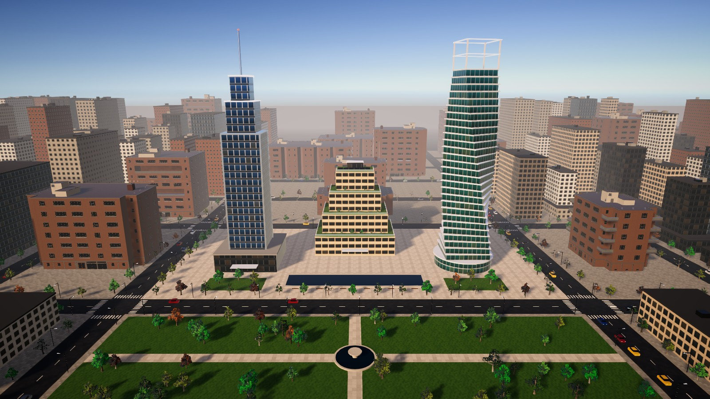

## Screenshots

### Display 1: touch control panel

| Choose a building | Choose an apartment | Swipe to look around |
|---|---|---|
| 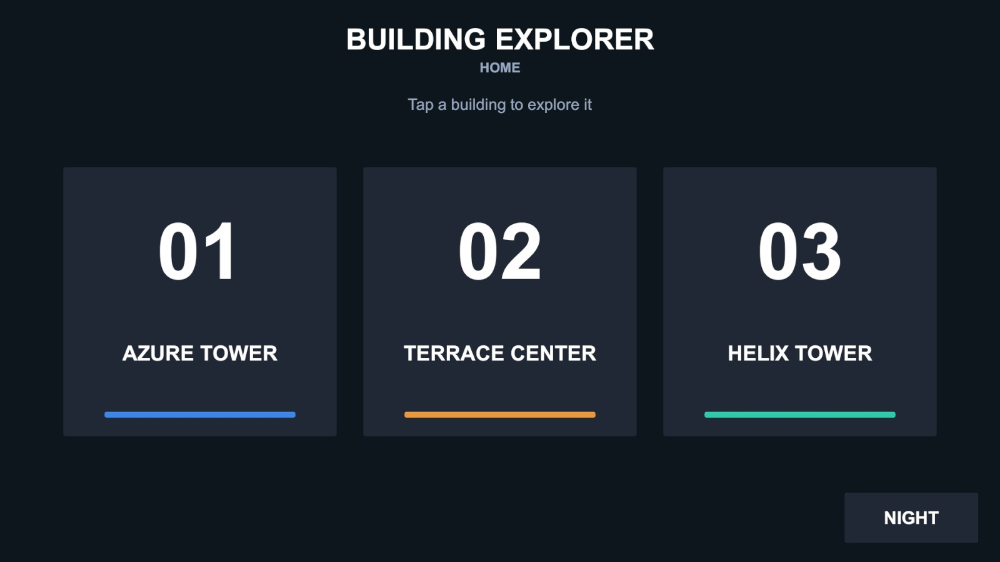 | 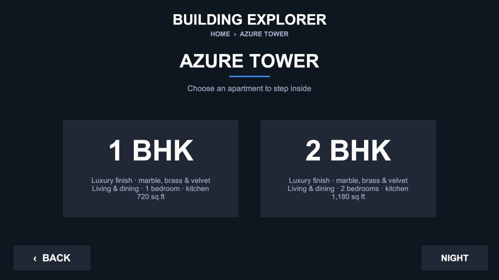 | 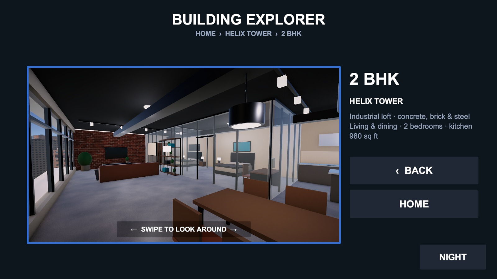 |

### Display 2: 3D preview

| Azure Tower | Terrace Center | Helix Tower |
|---|---|---|
| 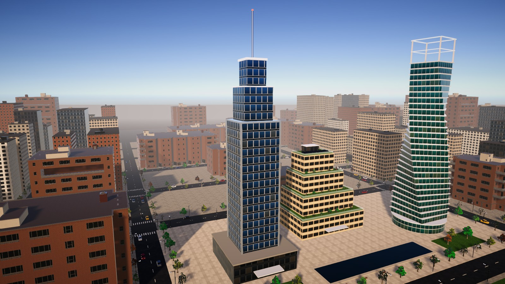 | 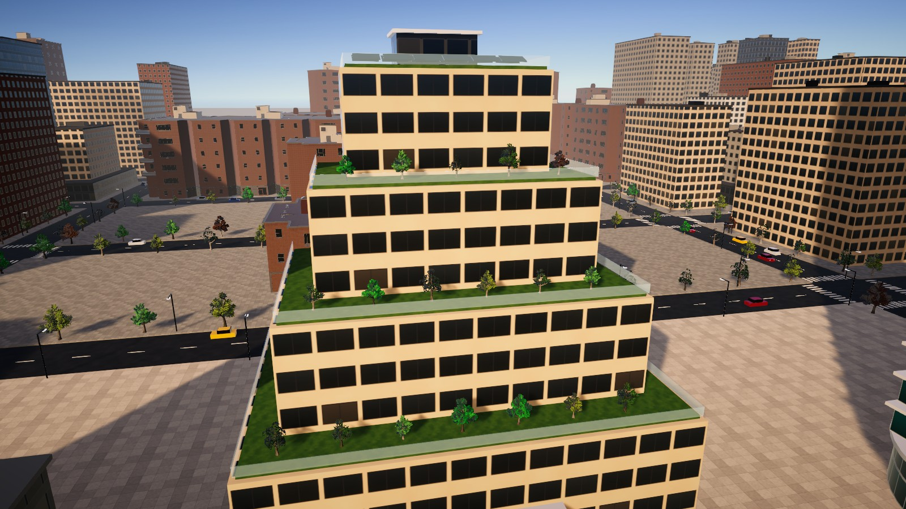 | 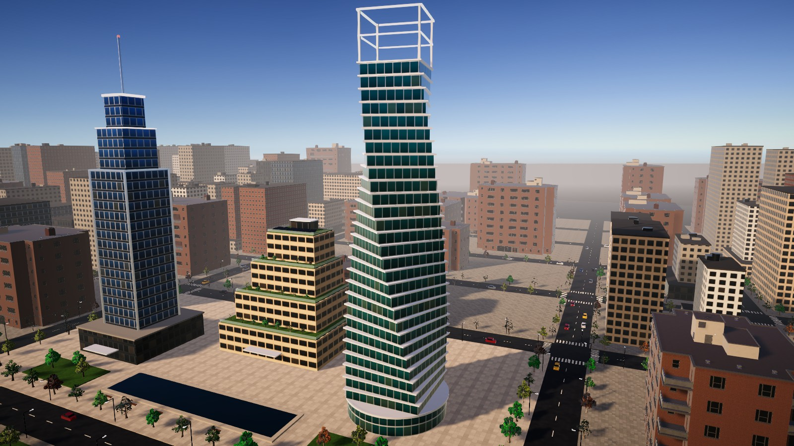 |

### Apartment interiors, with a different theme per building

| | 1 BHK | 2 BHK |
|---|---|---|
| **Azure Tower: Luxury** | 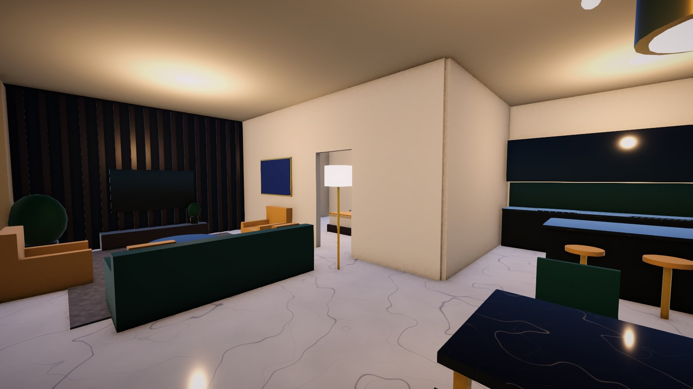 | 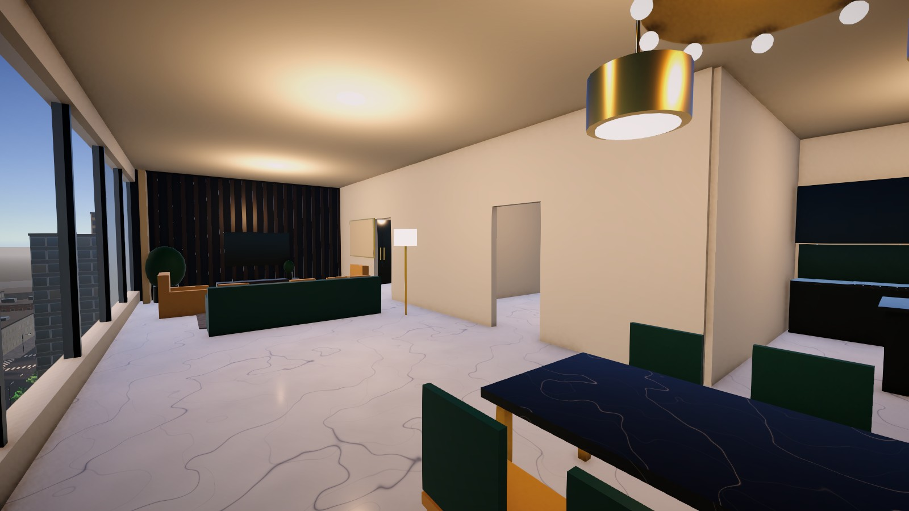 |
| **Terrace Center: Warm natural** | 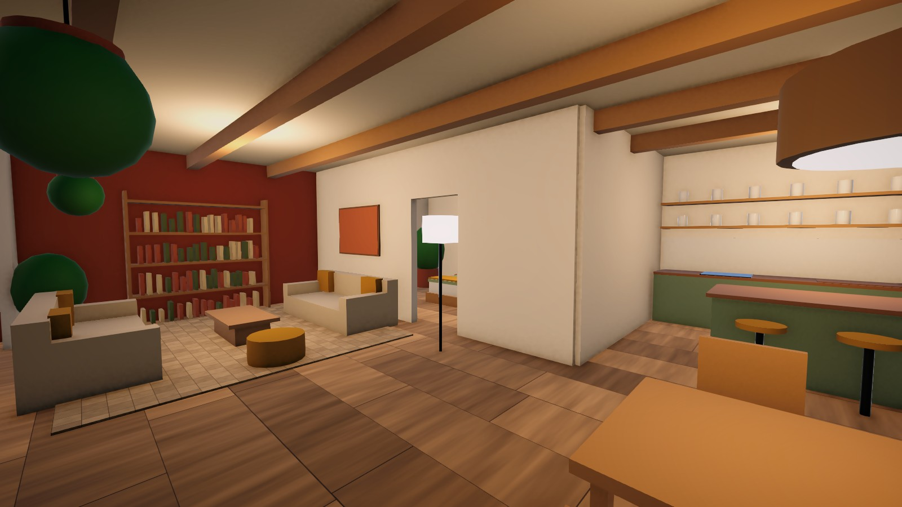 | 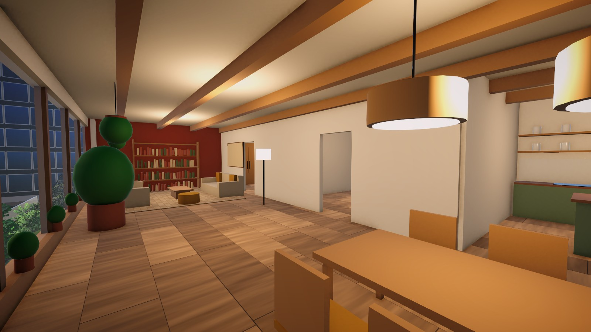 |
| **Helix Tower: Industrial loft** | 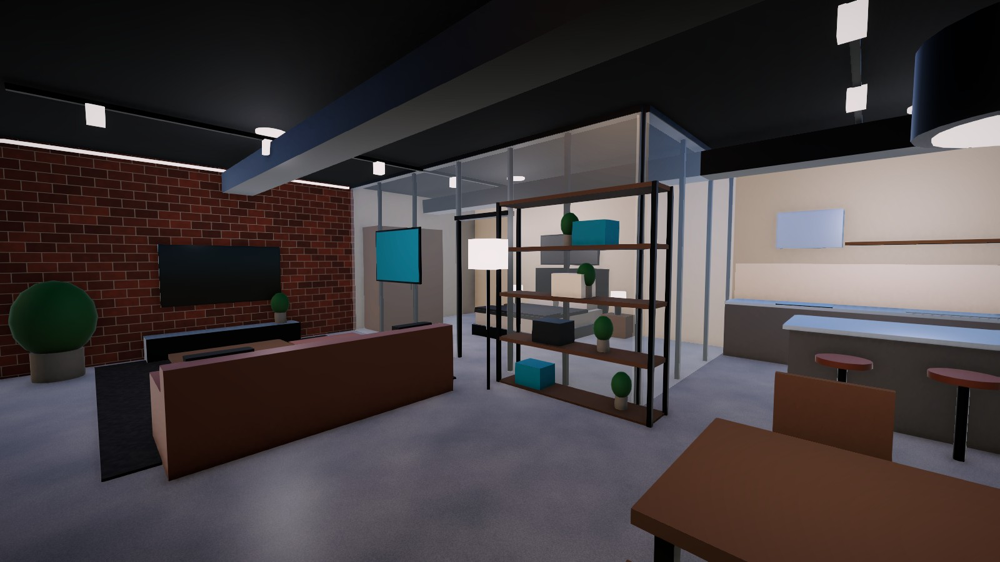 | 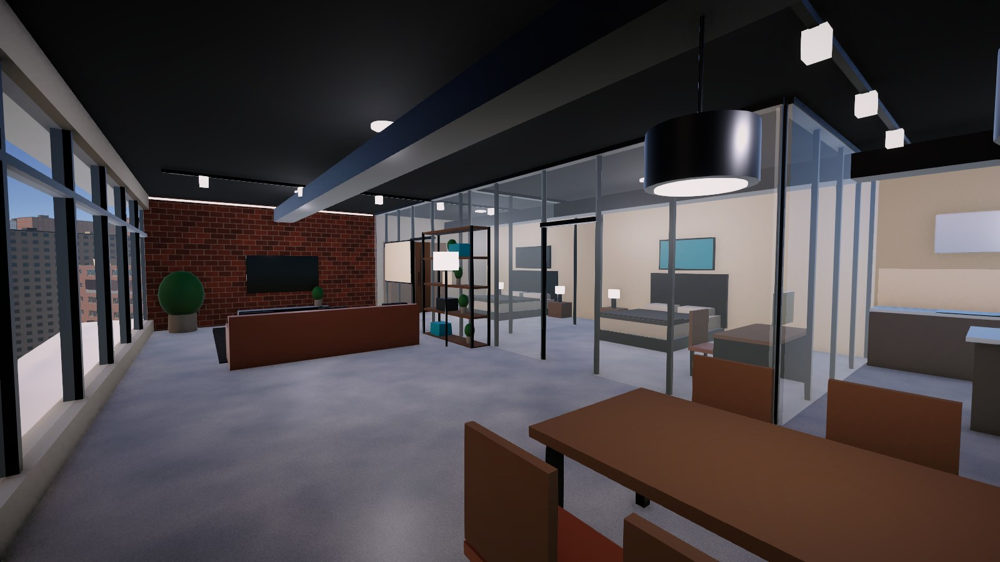 |

### Night mode, window view and the city

| Night | Helix Tower at night |
|---|---|
| 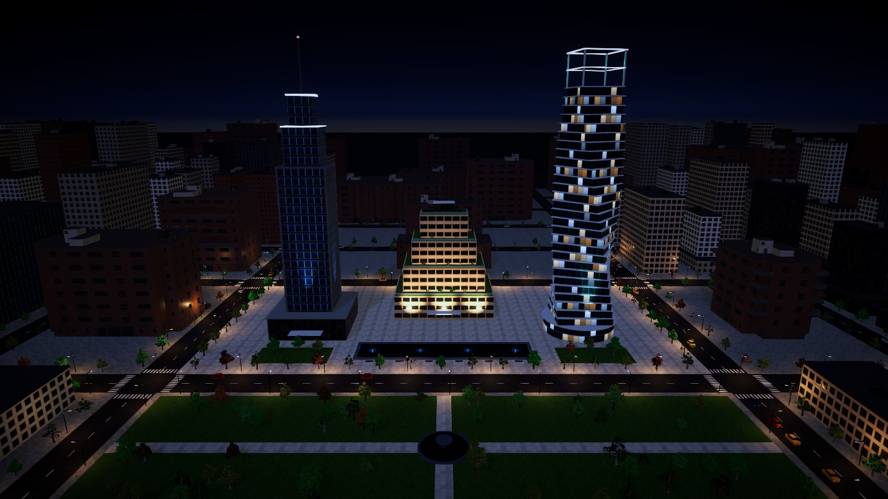 | 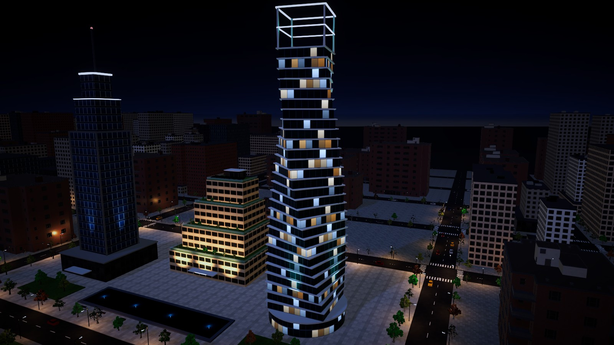 |

| View from a 2 BHK window | Park and plaza |
|---|---|
| 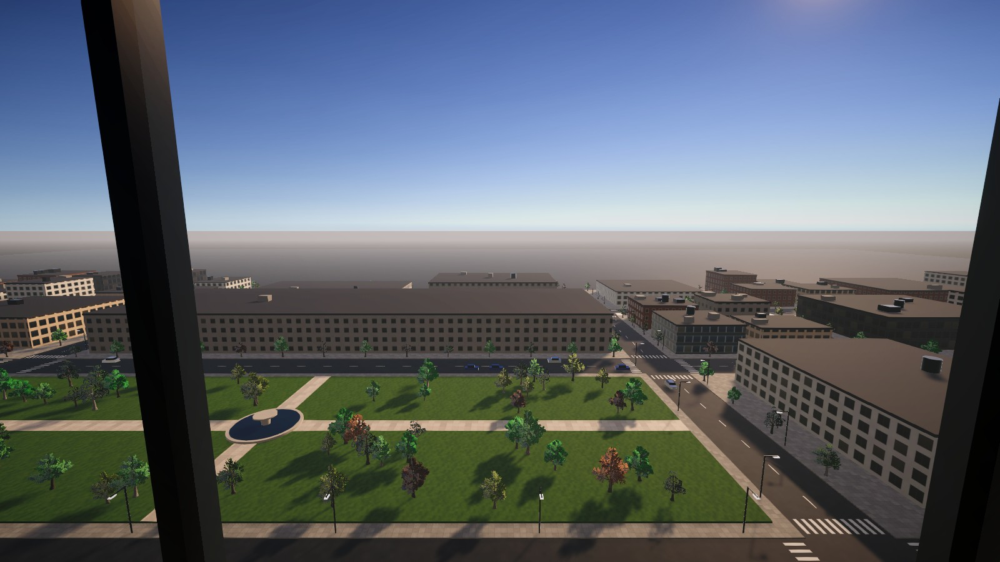 | 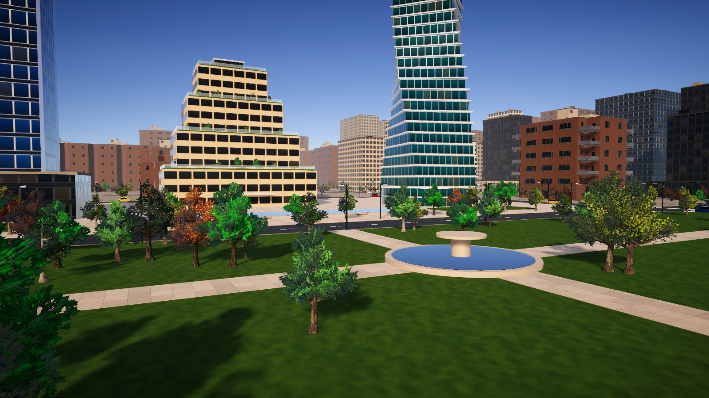 |

Display 2 shows the same frame as the panel's live preview, with a caption:

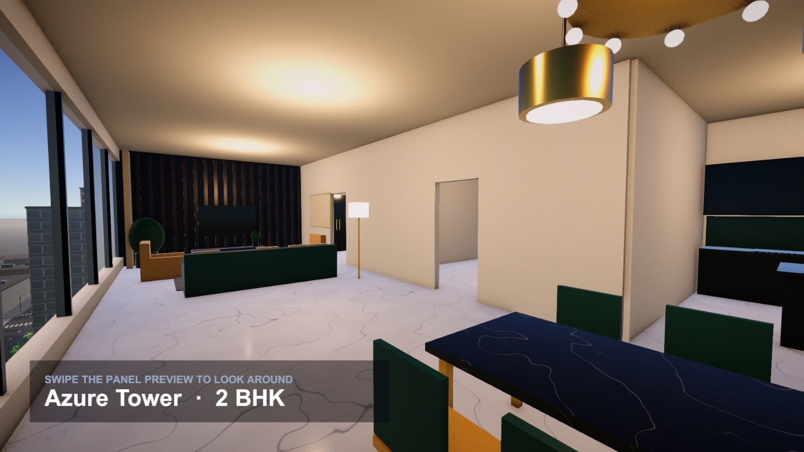

> Screenshots include the optional Asset Store packs (NYC buildings and trees). Without them, the city uses procedural buildings and trees.

## Features

- Central state machine with three states: Idle, BuildingView, ApartmentView.
- Cinemachine camera presets with ease-in-out blends. Apartment visits route exterior → window entry shot → interior.
- The 3D camera renders into a RenderTexture shown on both displays.
- Swipe-to-look with smooth damping, flick inertia and clamped pitch.
- Three interior themes, one per building: **Luxury** (marble, brass, velvet), **Warm natural** (oak, terracotta, plants) and **Industrial loft** (concrete, brick, glass bedrooms).
- A procedural city: textured facades, a street grid, cars, a park, street lights, lit windows at night, and reflections.
- Multi-display setup, with a side-by-side fallback when only one monitor is connected.

## Getting started

1. Clone the repo and open the folder in **Unity 6000.6** (Unity Hub → Add project from disk). Packages (URP, Cinemachine, Input System) are restored automatically.
2. *(Optional)* Import the Asset Store packs listed below.
3. Run **Tools → Touch Demo → Build Scene**. This generates `Assets/Scenes/TouchDemo.unity` and everything in `Assets/Generated/` in about 15 seconds. Neither is committed: the generated meshes alone are over 200 MB, and the builder recreates them identically.
4. Open two Game views (*Window → General → Game*) set to **Display 1** and **Display 2**, then press Play.

Keyboard shortcuts for testing: `1` `2` `3` choose a building or apartment, `B`/`Backspace` goes back, `H`/`Esc` goes home, `N` toggles day/night.

## Optional Asset Store packs (not included)

These packs aren't in the repository because their licences don't allow redistribution. The scene builder uses them if they're present, and falls back to procedural buildings and trees if they aren't.

| Pack | Used for | After importing |
|---|---|---|
| *(HDRP) NYC-Like City Buildings Set (PBR)* | Buildings around the plaza | Select the USA pack's `Materials` folder (the two packs share it) and run **Tools → Touch Demo → Convert Selected Folder's HDRP Materials to URP** |
| *USA Building With Terrace (HDRP, PBR)* | Optional Building 2 (`UseUsaBuildingForBuilding2` in `CityBuilder.cs`) | Same material conversion as above |
| *Trees_WorldSpace_FREE* | All trees in the city | Nothing. URP materials are generated automatically |

After importing, run **Tools → Touch Demo → Build Scene** again.

## Documentation

[KIOSK_SETUP.md](KIOSK_SETUP.md) covers:

- the full scene hierarchy
- every script and what it does
- the Inspector settings
- replacing the placeholder buildings with real models
- deploying to a two-screen Windows kiosk (display order, touch mapping, player settings)

## Project layout

```
Assets/Scripts/            Runtime: state manager, camera director, look-around, panel UI, day/night, displays
Assets/Scripts/Kiosk/      Kiosk-specific runtime scripts
Assets/Editor/             Scene generator, HDRP→URP material converter
Assets/Editor/City/        City, building, apartment, texture and mesh generators
KIOSK_SETUP.md             Setup and deployment guide
```
